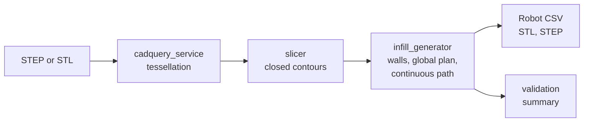
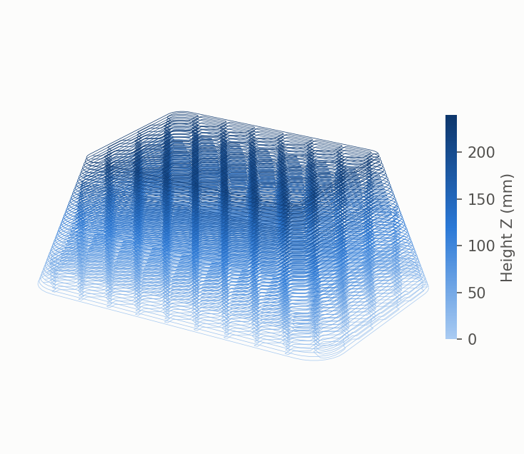
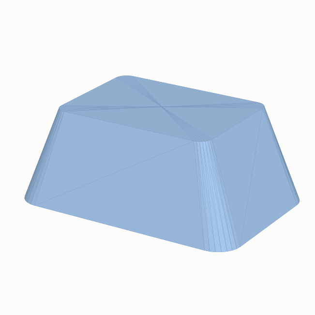
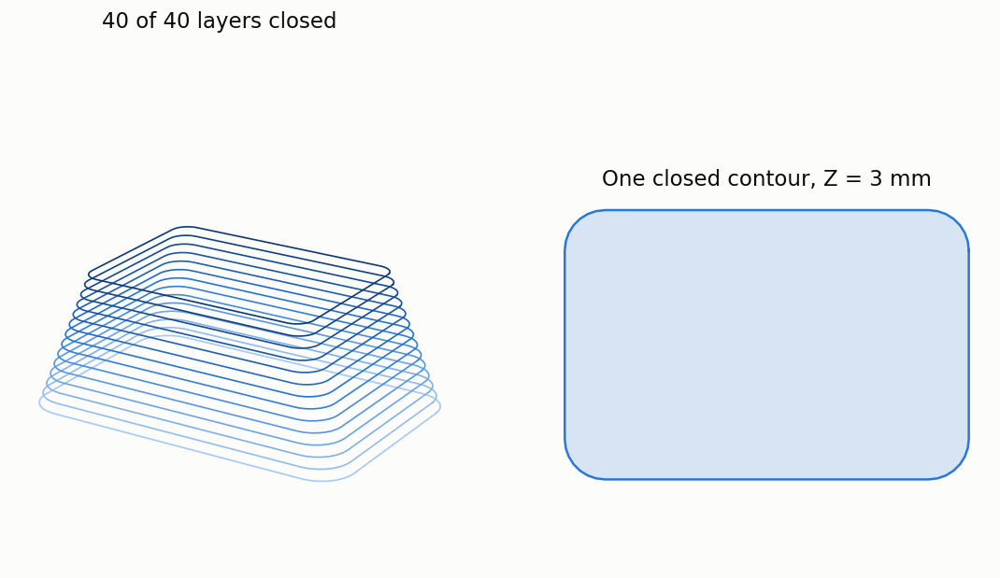
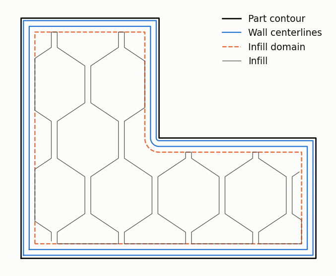
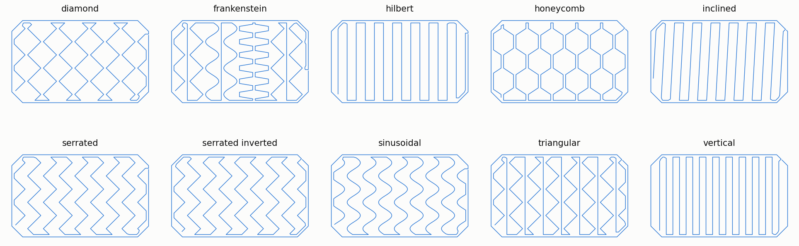
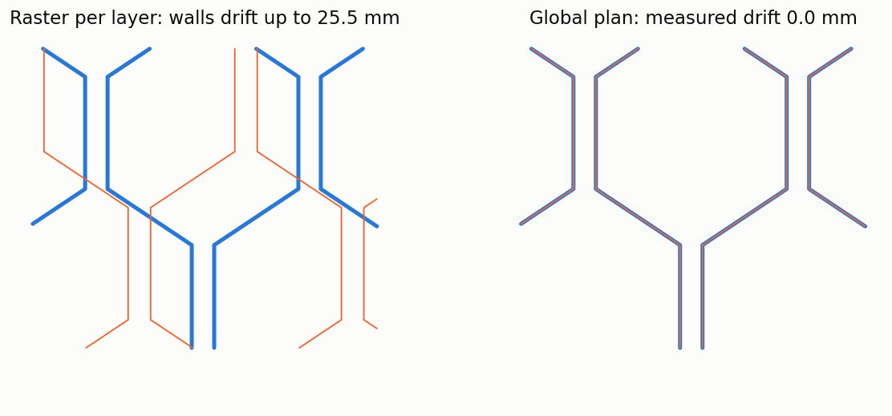
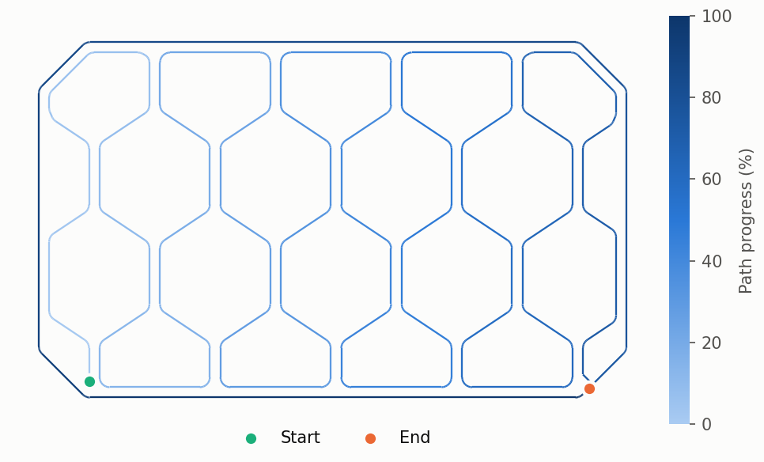

# Advanced CAx Tool

### ORGANIC — Horizon Europe Project

The **Advanced CAx Tool** is being developed within the Horizon Europe **ORGANIC project** to support the generative design and multi-objective optimisation of bio-inspired structures for additive manufacturing.

The tool aims to integrate process–structure–property–performance (PSPP) relationships into design workflows, enabling the exploration of engineering alternatives while accounting for manufacturing capabilities, material properties and sustainability considerations.

### Main objectives

- **Generative design:** Explore and generate bio-inspired lattice structures using computational design approaches.
- **Multi-objective optimisation:** Evaluate trade-offs between structural performance, material usage, manufacturing time, cost and sustainability.
- **Manufacturing integration:** Consider the capabilities and constraints of Fused Granulate Fabrication (FGF) additive manufacturing.
- **Predictive modelling:** Incorporate multiscale and data-driven models to support the prediction of process and product properties.
- **Sustainability by design:** Integrate safety, circularity and environmental considerations into design optimisation.

### Development status

The Advanced CAx Tool is under development as part of ORGANIC WP2 — Integrated Optimisation CAx System for AM Products.

The basic module, described below, is the first software component in this repository. Further components, documentation and usage instructions will be made available as approved for public release.

## Basic module

`organic_infill_generator` takes a CAD part to a continuous toolpath for extrusion additive manufacturing: what a basic slicer does, with large-format printing in mind.



The figure shows the tool's output for a drafted demo panel, 600 x 400 mm at the base and 240 mm tall: 40 layers, closed and filled with one honeycomb pattern, 380 m of path and no jump between infill and walls on any layer.

<p align="center"></p>

### Install

```bash
pip install -e .          # STL input
pip install -e ".[cad]"   # adds STEP input and output, through CadQuery
```

Python 3.10 or later.

### The complete process

```python
from organic_infill_generator import PipelineConfig, run_pipeline

result = run_pipeline("part.step", PipelineConfig(
    layer_height=1.5,
    line_width=6.0,
    infill_density=40.0,
    infill_pattern="honeycomb",
    num_walls=1,
    output_dir="results/part",
))

print(result.summary["validation"]["total_jumps"])  # 0: every layer is one path
print(result.toolpath_csv_path)
```

Each run writes the closed contours (JSON), the robot toolpath (CSV), the printed part (STL, and STEP on request) and a summary with the validation metrics and the time of each stage.

To run it on the demo panel, or on your own file:

```bash
python examples/run_pipeline.py
python examples/run_pipeline.py path/to/part.stl
```

### Modules

#### `cadquery_service`: from CAD to mesh

Converts between STEP and STL with CadQuery. The tessellation tolerance follows the size of the part. This is the only module that needs the optional CAD backend.

<p align="center"></p>

#### `slicer`: from mesh to closed contours

Intersects the mesh with one plane per layer and joins the resulting segments into closed contours, recovering which contours are holes of others. Segments that cannot form a cycle are reported as open chains; the slicer never invents geometry to bridge a gap in the mesh.

The closure step sits behind the `ContourCloser` interface. `slice_contours(..., contour_closer=...)` accepts any other implementation.

<p align="center"></p>

#### `infill_generator`: from contours to a continuous toolpath

Works in four steps, each with its own subpackage:

- **Walls and infill domain** (`geometry`): offsets the contour inward, half a bead for the first wall, so the deposited material keeps the part dimensions. The infill is clipped to the next virtual wall.

<p align="center"></p>

- **Pattern catalogue** (`patterns`): ten families, driven by a density percentage that is resolved into spacing, amplitude and step. The nominal density is an input: use `validation` to measure what the geometry realises.

<p align="center"></p>

- **Global pattern plan** (`generator`): the pattern field is generated once over the bounds of the whole part, and every layer clips that same field. Cell walls therefore stack across layers even when the contour changes. A raster computed in each layer's own bounding box drifts instead. The figure measures both on a drafted part of 12 layers; `tests/test_global_plan_alignment.py` keeps this as a regression test.

<p align="center"></p>

- **Continuous path** (`geometry.clipper_module`, `geometry.snake_repair`): joins the clipped columns and the walls into a single path per layer, so the extruder never stops. Connectors stay inside the part, and those that would lay the bead twice along an oblique wall are trimmed.

<p align="center"></p>

Before generating any geometry, `preflight` refuses what the process cannot deposit and reports what it can deposit but not as requested. Afterwards, `validation` measures jumps, coverage, realised density, self-overlaps and clearance to the walls.

### Outputs

The robot toolpath is one CSV for the whole part, ordered by height:

| Column | Content |
| :--- | :--- |
| `path_id`, `point_index` | One continuous path per layer, and the point's position along it |
| `layer` | Layer number, from 1 |
| `x`, `y`, `z` | Point on the bead centerline, in mm |
| `print_type`, `feature_type` | Process tags |
| `path_type` | `infill`, `wall` or `solid` |

The STL stacks one closed body per layer. They are not fused, so the file holds one volume per layer, and STEP is derived from that STL as a surface model.

### Current limitations

- Only the largest contour of each layer is printed, and its holes are ignored. If the wall offset splits a contour into islands, the largest island is filled and a warning is logged.
- A solid layer is one bead width throughout, so a part width that no whole number of beads can fill within 5 % compression is refused rather than over-extruded.
- The `hilbert` pattern chooses its detail from absolute step thresholds meant for small beads. At large-format bead widths it degrades to the coarsest level.
- Contour closure does not repair meshes: open gaps stay open, and a layer with no closed contour produces no toolpath.

### Tests

```bash
pip install -e ".[cad]"
python -m unittest discover -s tests -p "test_*.py"
```

Without the CAD backend, the STEP tests are skipped.

### Project information

- **Project:** ORGANIC — Biological Transformation of Additive Manufacturing Processes for the Sustainable Manufacturing of Bio-Inspired Products
- **Grant Agreement:** 101178127
- **Programme:** Horizon Europe
- **Work Package:** WP2 — Integrated Optimisation CAx System for AM Products
- **WP Leader:** Tampere University (TAU)

### Funding acknowledgement

This project has received funding from the European Union's Horizon Europe research and innovation programme under Grant Agreement No. 101178127.
